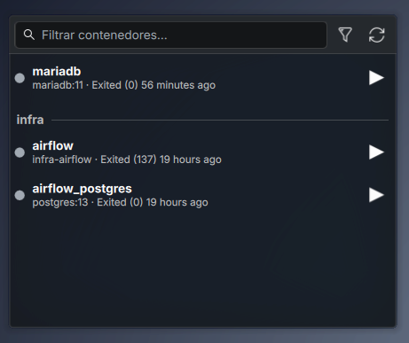

# Contenedores Docker — widget para KDE Plasma 6

Plasmoide para KDE Plasma 6 que muestra tus contenedores de Docker, su estado, y te deja levantarlos, reiniciarlos o detenerlos con un clic.



## Qué hace

- Lista todos los contenedores (`docker ps -a`), agrupados por proyecto de Docker Compose.
- Tarjeta oscura con estilo moderno: filas redondeadas, punto de estado con halo cuando el contenedor está corriendo y pulso al pasar el mouse (verde: corriendo, ámbar: pausado/reiniciando, rojo: muerto, gris: detenido).
- Los puertos publicados aparecen como chips; clic en uno para abrir `http://localhost:<puerto>`.
- Muestra imagen, estado y puertos publicados de cada contenedor.
- Botones para **levantar**, **reiniciar** y **detener**.
- Búsqueda por nombre, imagen, proyecto o puerto, y selector **Todos / Activos**.
- En el panel aparece como ícono con un tooltip que dice cuántos contenedores están corriendo; en el escritorio muestra la lista completa.
- Se actualiza solo: cada 3 s con el popup abierto, cada 10 s en el escritorio y cada 30 s en el panel cerrado. Si nada cambió, no redibuja la lista.

## Estilos

Clic derecho en el widget → **Configurar** → **Apariencia**:

- **Plasma**: componentes y colores de tu tema (respeta claro/oscuro, el color de acento y el fondo normal de los widgets). Se ve como los widgets que trae KDE.
- **Moderno** (por defecto): tarjeta oscura con efectos.

Solo se carga el diseño elegido: cada estilo vive en su propio archivo (`FullRepresentationPlasma.qml`, `FullRepresentationModern.qml`, …) y `StyleLoader.qml` abre únicamente el que toca.

### Agregar un estilo nuevo

1. Crea `contents/ui/FullRepresentation<Nombre>.qml` y `contents/ui/CompactRepresentation<Nombre>.qml`. Toman los datos y acciones de `root` (definidos en `main.qml`).
2. Agrega la opción en `contents/ui/configAppearance.qml` y su nombre en `StyleLoader.qml`.

## Requisitos

- KDE Plasma 6.0 o superior
- Docker instalado, y tu usuario con permiso para usarlo sin `sudo`:

  ```bash
  sudo usermod -aG docker $USER
  # cierra sesión y vuelve a entrar para que aplique
  ```

  Comprueba que funciona con `docker ps`.

## Instalación

```bash
git clone https://github.com/<tu-usuario>/docker-widget.git
cd docker-widget
kpackagetool6 --type Plasma/Applet --install .
```

Después:

1. Clic derecho en el escritorio o en el panel → **Añadir o gestionar widgets**.
2. Busca **Contenedores Docker** y arrástralo a donde quieras.

### Actualizar

```bash
git pull
kpackagetool6 --type Plasma/Applet --upgrade .
```

Si no ves los cambios, reinicia Plasma:

```bash
systemctl --user restart plasma-plasmashell
```

### Desinstalar

```bash
kpackagetool6 --type Plasma/Applet --remove local.dockercontainers
```

## Problemas comunes

- **"No se pudo hablar con Docker"**: el servicio no está corriendo (`sudo systemctl start docker`) o tu usuario no está en el grupo `docker`. El widget muestra el mensaje de error de `docker` debajo.

## Licencia

[MIT](LICENSE)
